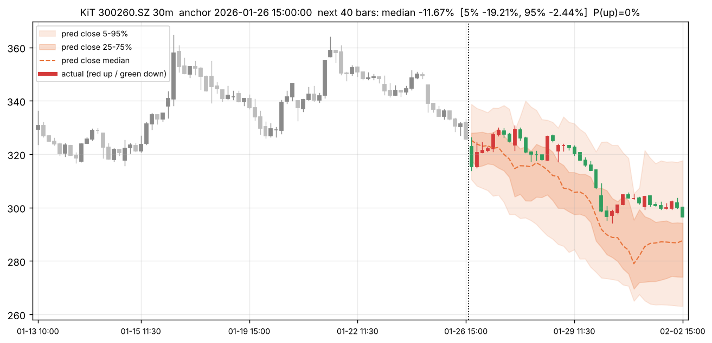
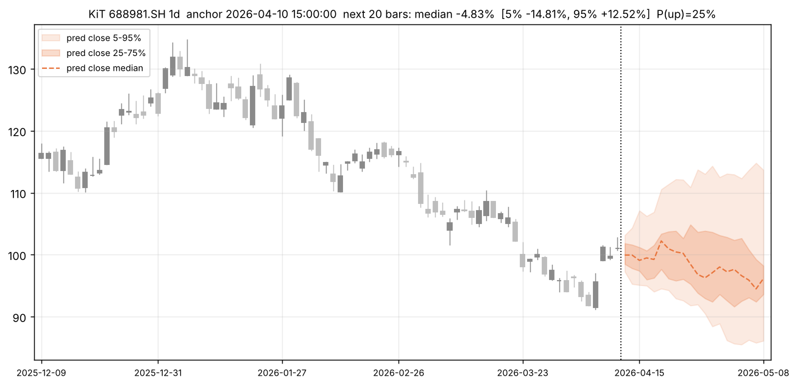

# KiT K 线预测模型：研究笔记 + 本地部署

> 来源：视频《KiT · 开源 K 线扩散大模型 · 官方结果核对》（@_zheergen），项目 <https://github.com/Luciferbobo/KiT>
>
> ⚠️ 仅供研究学习，不构成投资建议。

## 一句话结论

KiT 是一个真实可跑的开源 K 线「扩散 / 流匹配」基础模型（2.84 亿参数，权重 1.1GB）。它输出的是**未来走势的概率区间**，不是一个确定价格。
本目录提供一键部署脚本 `setup.sh`，以及一个能预测「真正未来」的脚本 `forecast.py`（官方脚本只能在已有数据上做回测）。
官方宣称的成绩有参考价值，但样本小、展示案例经过挑选，基线对比表也有数字对不上的地方（见下文）。**适合拿来研究，不要直接拿来下单。**

## 0. 实测记录（2026-11-15，云端容器：4 核 CPU、15GB 内存、无 GPU）

| 测试 | 结果 |
|---|---|
| 官方仓库自带的 GPU 结果（新莱应材 300260.SZ，30 分钟线，锚点 2026-01-26） | 预测中位数 **−8.91%**，5%–95% 区间 −17.1% ~ −4.0%，实际 **−8.93%**，40 根里 39 根落在区间内，**与视频一致** |
| 同一案例用官方脚本在 CPU 上重跑（同一个随机种子） | 用时 **14.5 分钟**；中位数 **−11.7%**，区间 −19.2% ~ −2.4%，实际 −8.93%，同样 39/40 落在区间内 |
| 同一案例用 `forecast.py` 跑 | 16 条路径与官方脚本的 CPU 结果**逐位一致**（说明推理流程完全相同） |
| `forecast.py` 向未来预测：中芯国际 688981.SH 日线，从 2026-04-10 往后 20 个交易日 | 用时 **4.9 分钟**；中位数 −4.8%，区间 −14.8% ~ +12.5%，16 条路径里 25% 上涨 |
| 视频里的示例命令 `--case 300750.SZ,30m,...` | **报错**：300750.SZ 不在 100 只示例股票里 |
| 推理内存占用 | 约 2.7GB（8GB 内存的电脑能跑） |

**怎么理解 CPU 和 GPU 的结果不一样？** 初始噪声由同一个随机种子生成，是相同的，但官方用 GPU bf16 精度，CPU 上是 fp32。32 步积分会放大这点数值差异，导致中位数从 −8.9% 变成 −11.7%。另外只用 16 条路径算中位数，本身就有约 ±1.2 个百分点的抽样波动。结论是：**方向（下跌）和区间是稳的，精确到小数点的点预测不是。** 视频里「−8.91% 对 −8.93%」这种几乎完全命中，有运气成分。想让结果更稳，可以加大 `--paths`（如 64），代价是耗时成比例增加。

<table><tr>
<td><br><sub>新莱应材 30m（CPU 复测）：灰色为历史，橙色带为预测区间，红绿为真实走势</sub></td>
<td><br><sub>中芯国际日线：从示例数据最后一天往后预测 20 个交易日</sub></td>
</tr></table>

> 中芯国际这次预测跨过了五一假期，而官方交易日历只到 2026-04-10，所以脚本给出了警告：未来日期只跳过周末、不跳节假日。实际使用时请用 `--calendar` 提供最新交易日历。

---

## 1. 视频讲了什么

| 视频里的说法 | 出处 | 我的核对 |
|---|---|---|
| 新莱应材 30 分钟线，预测 −8.91%，实际 −8.93% | 官方示例 `results/infer_for_pred/300260.SZ_30m_20260126` | 数字属实（简单涨跌幅口径）；但换成 CPU 重跑，中位数是 −11.7%（见 §0） |
| 「猜谁涨得多」排序准确度第一，平均 RankIC 0.0571 | README Table 1 | 表里 Mean 列有 9/12 行与各周期平均值对不上（见 §3） |
| 「猜谁波动大」RankIC 0.66，明显好于 GARCH 0.52 | README Table 2 | 数字自洽（Mean = 7 个周期的平均） |
| 官方回测：小时线三个月扣费后 +48.9% | `results/backtest_results/summary_top10.csv` | 数字属实，但只有 12 个调仓窗口、100 只股票，1 分钟线是亏的（−6.3%） |
| 7 个官方案例，97.4% 的真实 K 线落在 5%–95% 区间 | 作者自己用官方 npz 核对 | 7 个案例是官方挑的展示样本，不是随机抽样 |
| 需要 6GB+ 显存的 NVIDIA 显卡 | README | **没有显卡也能跑**：代码会自动退回 CPU（fp32），只是慢 |

## 2. KiT 是什么、怎么工作

- **全称**：KiT: A Foundation Model for Candlestick Time-Series Forecasting via Diffusion Transformers（作者 Boyu Zhang, Haorui Li），代码协议 **AGPL-3.0**。
- **训练数据**：美股、A 股、加密货币的数十亿根 K 线，7 个周期：1m / 5m / 15m / 30m / 1h / 2h / 1d。
- **一根 K 线 = 5 个数**：OHLCV 被编码成对数比率
  `r_gap = ln(开/昨收)`、`r_body = ln(收/开)`、`r_up = 上影线`、`r_dn = 下影线`、`v = ln(成交量/成交量EMA)`。
  因为全是比率，模型不关心股价高低和成交量单位。
- **生成方式**：历史 + 待预测区间拼成一个序列交给 Transformer（DiT），历史原样保留，只「填空」未来部分。用流匹配（flow matching）从噪声积分 32 步得到一条路径，**一次采样 16 条路径**，所以给出的是区间。
- **条件信息**：市场、行业、个股 embedding（checkpoint 自带 3914 只 A 股 + 888 只美股 + 28 个币种）、周期、时间/交易时段/星期/月份等日历特征。
- **窗口长度固定**（由模型决定，不能改）：

| 周期 | 1m | 5m | 15m | 30m | 1h | 2h | 1d |
|---|---|---|---|---|---|---|---|
| 需要的历史根数 Lc | 1200 | 960 | 800 | 640 | 400 | 360 | 250 |
| 预测的根数 Lh | 120 | 96 | 64 | 40 | 20 | 20 | 20 |

- **两个模型权重**（Hugging Face `Lucifer744/KiT_model`）：

| 权重 | 市场 | 训练截止 | 用途建议 |
|---|---|---|---|
| `step_market_284M`（默认） | A 股 + 美股 + 加密 | 2025-12-31 | 论文成绩用的就是它；评测 2026 年数据时没有数据泄漏 |
| `step_market_284M_train260410` | 仅 A 股 | 2026-03-09 | 更新，适合预测近期行情；**不要**用它评测 2026-01 到 03 的数据（训练时见过） |

- **尚未开源**：训练代码、数据准备脚本。所以目前不能自己训练或微调。

## 3. 对官方成绩的几点保留

1. **Table 1（收益排序 RankIC）的 Mean 列对不上**：KiT、Kronos-base-FT、TSFlow 三行的 Mean 等于 7 个周期的平均值，其余 9 个基线都对不上（例如 Chronos-2 写的是 0.0054，按表中数字平均是 0.0338）。可能是部分基线的负号在表格里丢了，也可能 Mean 不是简单平均。按表中数字重算，KiT 仍然第一，但领先很小（0.0570 vs Chronos-Bolt 0.0554）。Table 2（波动率）基本自洽，只有 TimeGrad 一行对不上。
2. **RankIC 0.057 的含义**：它衡量的是「横截面上谁涨得多」的排序相关性，在量化里算一个不错的因子水平，但远远谈不上「准确预测价格」。
3. **回测样本很小**：2026-01-05 到 04-10 约 3 个月，100 只示例股票，小时线只有 12 个调仓窗口，日线只有 3 个。同期 100 只股票的等权平均是 +2.0%，中位数是 −6.4%。扣费后 +48.9% 有很大的运气成分，不能外推。
4. **展示案例是挑过的**：−8.91% vs −8.93% 是官方选来展示的案例。同一个案例的 5%–95% 区间是 −17.1% 到 −4.0%，区间本身很宽。
5. **只预测走势分布**：不考虑涨跌停以外的交易约束、新闻、基本面。

## 4. 本地部署

### 4.1 硬件

| 配置 | 可行性 |
|---|---|
| NVIDIA 显卡 6GB+ 显存（官方推荐） | 最佳：bf16 推理，单个案例几秒到几十秒 |
| 只有 CPU，内存 8GB+ | 可以跑（fp32）。4 核实测：日线约 5 分钟，30 分钟线约 15 分钟；1 分钟线的序列最长，会更慢 |
| Apple Silicon (MPS) | 未测试；脚本支持 `--device mps`，建议先用 CPU |

磁盘：代码 + 依赖约 1–4GB（CUDA 版 PyTorch 更大），模型 1.1GB，示例数据 1.2GB。

### 4.2 一键部署（Linux / macOS）

```bash
git clone https://github.com/david8112/Hello_Github.git
cd Hello_Github/kit-local
bash setup.sh              # 代码 + 依赖 + 默认模型 + 100 只股票示例数据
# bash setup.sh --both     # 再下载 A 股专用的新模型
# 国内网络慢：export HF_ENDPOINT=https://hf-mirror.com 后再运行
```

脚本会做这些事：
1. 把 KiT 官方代码 clone 到 `kit-local/KiT`，固定在验证过的 commit `78acec5`。
2. 在 `KiT/.venv` 建虚拟环境：有 NVIDIA 显卡装 CUDA 版 PyTorch，没有就装 CPU 版。
3. 从 Hugging Face 下载模型和示例数据。
4. 自检并打印可用设备。

### 4.3 Windows（手动）

```powershell
git clone https://github.com/Luciferbobo/KiT.git kit-local\KiT
cd kit-local\KiT
git checkout 78acec5f9de5787672f0f9cc201f73c6e3526c43
python -m venv .venv
.venv\Scripts\pip install torch --index-url https://download.pytorch.org/whl/cu121   # 有 NVIDIA 显卡；没有就去掉 --index-url
.venv\Scripts\pip install numpy pandas pyarrow matplotlib huggingface_hub
.venv\Scripts\hf download Lucifer744/KiT_model --include "config.json" "step_market_284M/*" --local-dir ckpt
.venv\Scripts\hf download Lucifer744/KiT_data_demo --repo-type dataset --local-dir data
copy ckpt\step_market_284M\step_market_284M.pt ckpt\step_market_284M.pt
```

> 下载时如果报 `cas-server.xethub.hf.co` 相关错误（Xet 协议被代理或镜像拦截），先执行 `$env:HF_HUB_DISABLE_XET=1` 再下载，就会改用普通 HTTPS。`setup.sh` 默认就是这样做的。

> 注意 1：视频里的示例命令 `--case 300750.SZ,30m,"2026-03-10 11:30"` 用示例数据跑会直接报错，因为 300750.SZ（宁德时代）不在那 100 只示例股票里。示例股票列表见 `KiT/data/instruments.json`。
>
> 注意 2：视频和官方 README 里的 `huggingface-cli download Lucifer744/KiT_model --local-dir ckpt/` 会下载**两个**模型（2.3GB），而且模型文件在子目录 `ckpt/step_market_284M/` 下。官方脚本默认找的是 `ckpt/step_market_284M.pt`，所以要么加 `--ckpt ckpt/step_market_284M/step_market_284M.pt`，要么像上面那样复制或软链接一份。`setup.sh` 已经处理了这一点。

## 5. 使用

以下命令都在 `kit-local/` 目录下执行，`PY=KiT/.venv/bin/python`（Windows 用 `KiT\.venv\Scripts\python`）。

### 5.1 复现官方案例（回测模式，需要锚点之后有真实数据）

```bash
cd KiT
.venv/bin/python eval/infer_for_pred.py --case 300260.SZ,30m,2026-01-26      # 视频里的新莱应材
.venv/bin/python eval/infer_for_pred.py                                     # 7 个官方案例（CPU 上较慢）
```

输出在 `KiT/results/infer_for_pred/`：每个案例一张 PNG、一个 npz，以及 `summary.csv`。
注意：官方脚本打印的「收益」是**对数收益**，视频里说的是**简单涨跌幅**。同一个案例，对数收益 −9.34% 就等于简单涨跌幅 −8.91%。`forecast.py` 打印的是简单涨跌幅。

### 5.2 预测未来（`forecast.py`，本目录新增）

官方脚本要求锚点之后已经有 Lh 根真实 K 线，所以只能事后核对。`forecast.py` 用同样的模型和推理代码，但只需要历史数据，直接预测最后一根 K 线之后的走势：

```bash
# 用示例数据：中芯国际从 2026-04-10（示例数据最后一天）往后预测 20 个交易日
$PY forecast.py --code 688981.SH --scale 1d

# 指定锚点；如果文件里锚点之后有真实数据，会叠加到图上并计算区间覆盖率
$PY forecast.py --code 300260.SZ --scale 30m --anchor 2026-01-26

# 用自己的数据
$PY forecast.py --code 600519.SH --scale 1d --file my_600519_daily.csv
```

终端会打印中位数涨跌幅、5%–95% 区间、上涨路径占比。`outputs/` 里有：
- `*.png`：灰色是历史，橙色带是预测区间，红绿 K 线是真实走势（如果有）
- `*.csv`：每根未来 K 线的收盘价分位数（q05/q25/q50/q75/q95）和代表路径的 OHLCV
- `*.npz`：16 条路径的完整 OHLCV

### 5.3 用自己的数据

CSV 或 parquet，列名为 `datetime, open, high, low, close, volume`（也认 akshare 的中文列名 `日期/时间, 开盘, 最高, 最低, 收盘, 成交量`）。要求：

- **用复权价**（前复权），否则除权缺口会被当成真实跳空。
- **分钟线的时间戳是 K 线结束时间**：5m 第一根是 09:35，1h 是 10:30 / 11:30 / 14:00 / 15:00，2h 是 11:30 / 15:00。脚本会检查，不合规就报错。日线只写日期也可以。
- **历史长度**：至少 Lc 根（日线 250 根 ≈ 1 年），建议再多给约 60 个交易日，用于成交量 EMA 预热。
- **交易日历**：官方 `trade_dates.csv` 只到 2026-04-10。之后的日期，脚本会把你数据里出现过的交易日补进去，但对**未来**的节假日只会跳过周末。如果预测区间跨长假（如国庆、春节），用 `--calendar` 提供最新交易日历（第一列为 YYYYMMDD）。
- 股票代码用 `600519.SH` / `000001.SZ` 格式。checkpoint 覆盖了 3914 只 A 股；不在列表里的代码会用通用 embedding，并给出提示。

获取数据的一种方式是 akshare（以下代码**未在本次部署中测试**，接口以 akshare 文档为准）：

```python
import akshare as ak
df = ak.stock_zh_a_hist(symbol="600519", period="daily", start_date="20240101", adjust="qfq")
df.to_csv("my_600519_daily.csv", index=False)   # 中文列名 forecast.py 能直接识别
```

### 5.4 全量评测与回测（强烈建议用 GPU）

```bash
cd KiT
.venv/bin/python eval/infer_for_eval.py   # 100 只股票 × 7 个周期 × 全部锚点，CPU 上要跑很多天
.venv/bin/python eval/cal_metrics.py
.venv/bin/python eval/backtest.py --top 10
```

## 6. 许可

KiT 代码采用 AGPL-3.0。本目录只包含部署脚本和 `forecast.py`（调用 KiT 的推理 API），KiT 代码由 `setup.sh` 从官方仓库拉取，不随本仓库分发。如果你修改 KiT 并以网络服务形式对外提供，需要按 AGPL 开源你的修改。
